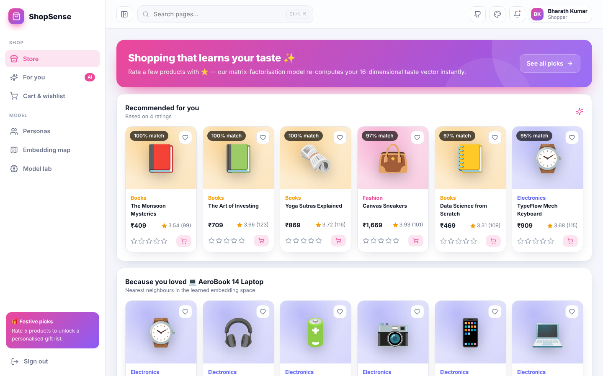
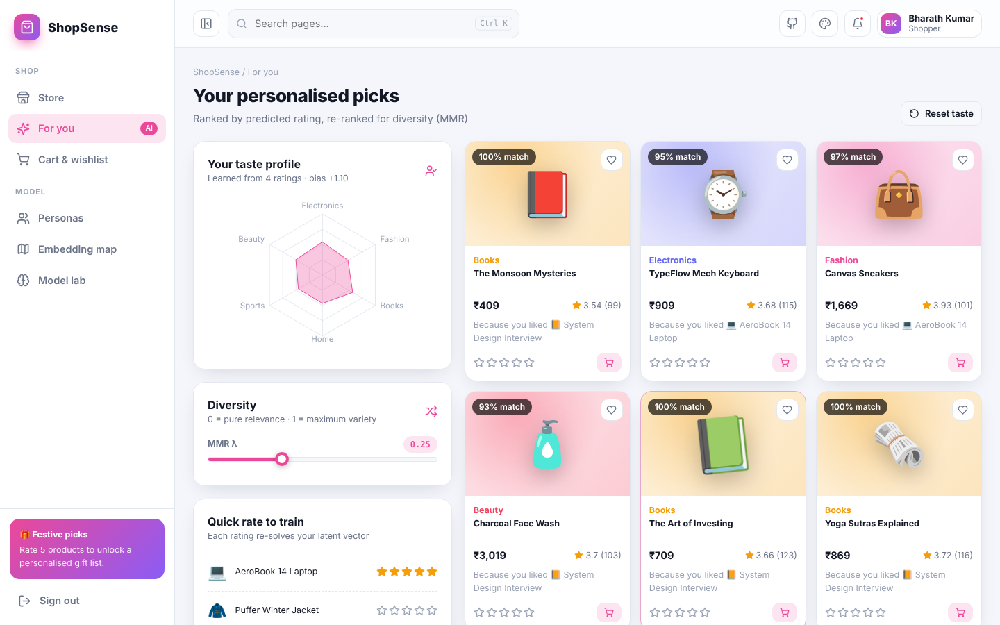
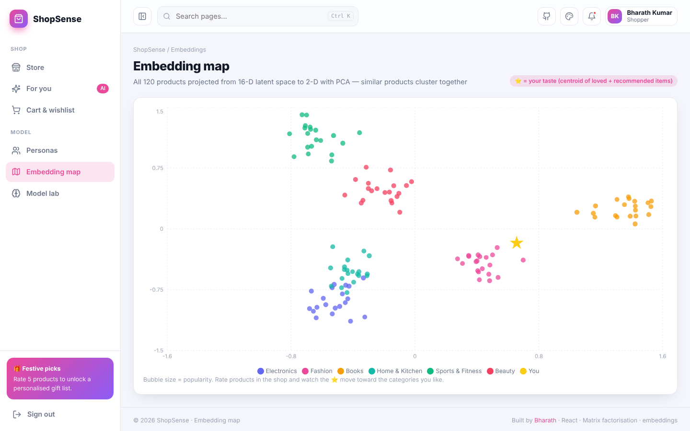
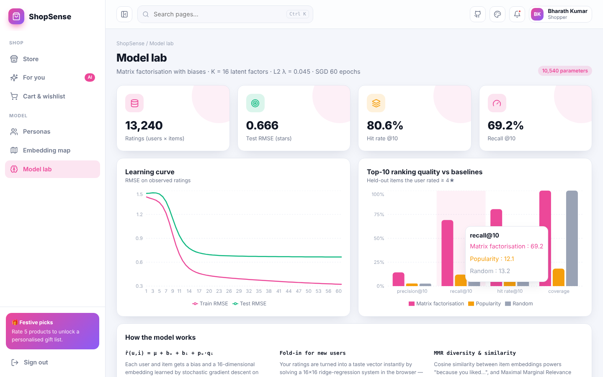

<div align="center">

# 🛍️ ShopSense — AI Product Recommendation Engine

**A latent-factor recommender (matrix factorisation with biases, 16-D embeddings) trained on 13k ratings. Rate products and your taste vector is re-solved in the browser instantly — powering personalised picks, "because you liked…" rows, diversity re-ranking and an interactive embedding map.**

[](https://preciousbharath.github.io/SHOPSENSE-AI-PRODUCT-RECOMMENDER/)


### 🔗 [preciousbharath.github.io/SHOPSENSE-AI-PRODUCT-RECOMMENDER](https://preciousbharath.github.io/SHOPSENSE-AI-PRODUCT-RECOMMENDER/)
Demo login → **demo@shopsense.app** / **Demo@1234**

</div>

---

## 📊 Results (held-out ratings)

| Model | Precision@10 | Recall@10 | Hit rate@10 | Catalogue coverage |
|---|---|---|---|---|
| ⭐ **Matrix factorisation (ours)** | **0.144** | **0.692** | **0.806** | 100 % |
| Popularity | 0.027 | 0.121 | 0.230 | 18 % |
| Random | 0.026 | 0.132 | 0.248 | 100 % |

Rating prediction: **test RMSE 0.67 stars** (500 users × 120 products, 13,240 ratings, 22 % density).

## ✨ Features

- 🔐 **Register / login** with roles, password strength meter, demo account
- 🏬 **Store** — 120 products in 6 categories with search, category chips and sorting; rate any product ⭐ and the page re-personalises
- ✨ **Recommended for you** with match %, **"Because you loved …"** nearest-neighbour row (cosine similarity of item embeddings)
- 🎯 **For you** — 16 personalised picks with explanations, **MMR diversity slider**, taste radar by category, quick-rate panel, reset taste
- 👥 **Personas** — inspect trained users (tech enthusiast, bookworm, fitness freak…): history vs model picks vs popularity baseline
- 🗺️ **Embedding map** — PCA projection of all item embeddings; categories form clusters, ⭐ shows where your taste sits
- 🧠 **Model lab** — learning curves, precision/recall/hit-rate/coverage vs baselines, model maths
- 🛒 **Cart & wishlist** with "frequently explored together"
- 🎨 5 themes, 6 accents, animation toggle, responsive

## 🧠 How it works

```
r̂(u, i) = μ + b_u + b_i + p_u · q_i          (K = 16 latent factors)

ml/train.py   simulate catalogue + users with hidden category/price/style tastes
              → SGD with L2 (60 epochs) → RMSE & top-K evaluation vs baselines
              → PCA of item embeddings → export src/model/model.json

browser       fold-in: p_new = (QᵀQ + λI)⁻¹ Qᵀ(r − μ − b_i − b_u)   (16×16 solve, < 1 ms)
              ranking: predicted rating → optional MMR re-rank for diversity
```

```bash
cd ml && pip install -r requirements.txt && python train.py
```

## 🖼️ Screenshots

| Store | For you |
|---|---|
|  |  |
| **Embedding map** | **Model lab** |
|  |  |

## 🚀 Run locally

```bash
git clone https://github.com/PreciousBharath/SHOPSENSE-AI-PRODUCT-RECOMMENDER.git
cd SHOPSENSE-AI-PRODUCT-RECOMMENDER
npm install && npm run dev
```

> Products and brands are fictional; ratings are simulated for learning purposes.

## 👨‍💻 Author

**Bharath** — AI/ML Trainer · Software Developer · Madurai  
[GitHub](https://github.com/PreciousBharath) · [LinkedIn](https://linkedin.com/in/connectbharath) · [Portfolio](https://itsbharathportfolio.netlify.app)
